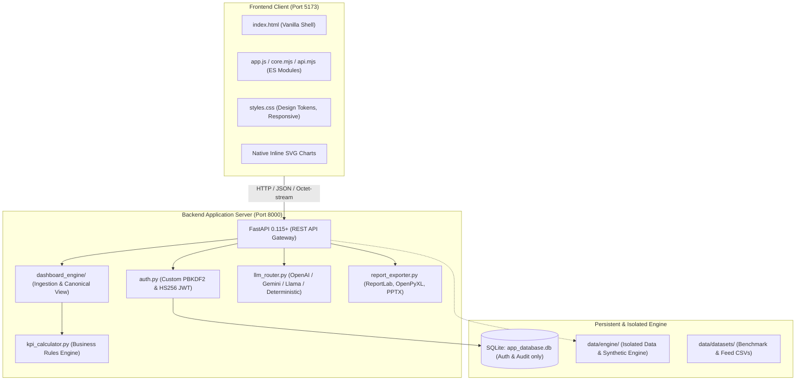
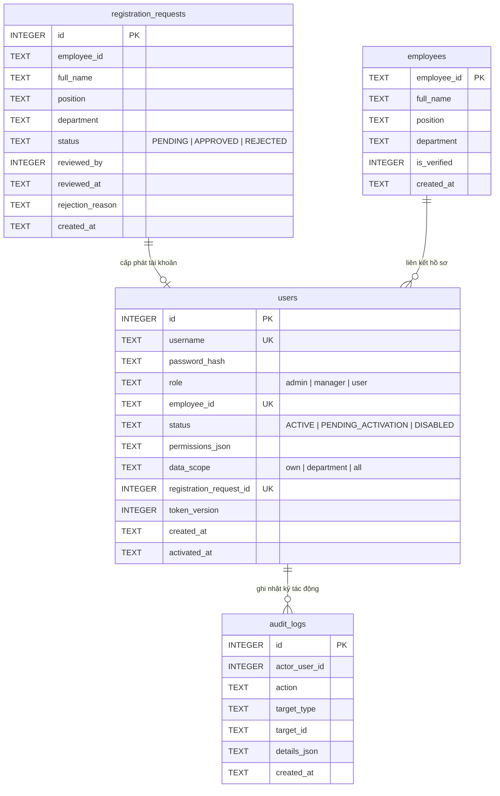
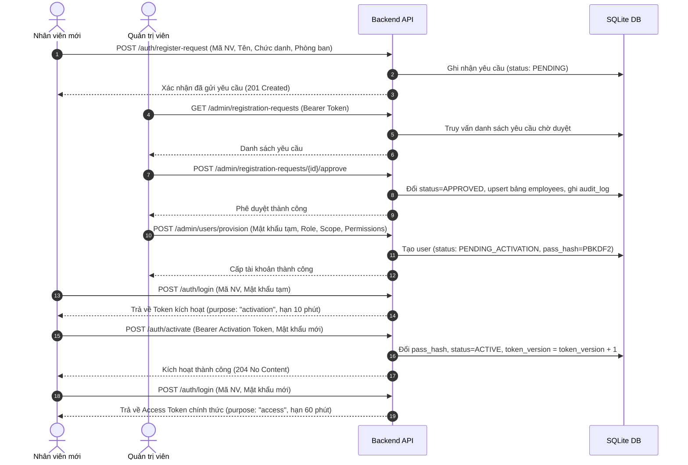
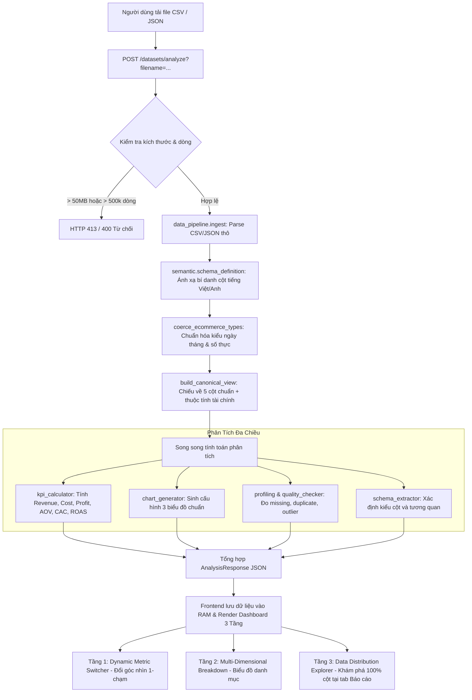

# ARCHITECTURE.md — Kiến Trúc Hệ Thống & Luồng Xử Lý Dữ Liệu

Tài liệu này mô tả chi tiết công nghệ, cấu trúc thư mục, mô hình dữ liệu và các luồng nghiệp vụ chính của hệ thống **AI BI Dashboard (v2)**.

---

## 1. Công Nghệ Đang Sử Dụng (Technology Stack)



- **Backend:** Python 3.11+, FastAPI (REST routing & DI), Pydantic v2 (Strict validation), Uvicorn (ASGI server), httpx (HTTP client cho LLM adapters).
- **Security & Cryptography:** PBKDF2-SHA256 (310,000 vòng lặp) băm mật khẩu, tự viết bộ mã hóa/giải mã và xác thực chữ ký JWT HMAC-SHA256 không dùng thư viện ngoài nhằm kiểm soát triệt để cấu trúc token.
- **Frontend:** Vanilla HTML5 / Modern CSS / ES6+ Modules thuần túy. Hoàn toàn không dùng framework (React/Vue/Angular), không cần bước đóng gói (Vite/Webpack), kết nối trực tiếp qua `fetch` API.
- **Data Engine:** pandas, numpy, scipy (đo phân phối Wasserstein, khoảng cách Jensen-Shannon, DCR).
- **Tài liệu & Xuất báo cáo:** ReportLab (PDF), OpenPyXL (Excel XLSX), python-pptx (PowerPoint), CSV/HTML tiêu chuẩn.

---

## 2. Cấu Trúc Thư Mục (Directory Layout)

```text
./ (AI_BI_DASHBOARD_V1)
├── backend/                       # Ứng dụng Backend chính (Monolith Modular)
│   ├── main.py                    # Điểm khởi tạo FastAPI, middleware, routes chính
│   ├── config.py                  # Nạp cấu hình từ biến môi trường (Settings)
│   ├── auth.py                    # Quản lý người dùng, DB auth, JWT, RBAC
│   ├── chatbot/                   # Trợ lý AI (LLM Router, Prompts, RAG, Text-to-SQL)
│   ├── dashboard_engine/          # Ingest tệp thô, chuẩn hóa, tính KPI, sinh biểu đồ, xuất file
│   ├── eda/                       # Phân tích khám phá, kiểm tra chất lượng dữ liệu
│   ├── schema_learning/           # Suy luận lược đồ dữ liệu và quan hệ giữa các bảng
│   └── synthetic_generator/       # Bộ sinh dữ liệu tổng hợp (Bootstrap, SDV, LLM agent)
├── Frontend/                      # Ứng dụng giao diện người dùng (SPA tĩnh)
│   ├── index.html                 # Khung trang web cơ sở
│   ├── app.js                     # Điều phối giao diện, render trạng thái và xử lý sự kiện
│   ├── core.mjs                   # Hàm tiện ích thuần túy (format số, ánh xạ cột, phân quyền)
│   ├── api.mjs                    # Client giao tiếp HTTP API
│   ├── styles.css                 # Hệ thống màu pastel, bố cục 2 cột, responsive
│   ├── serve.py                   # Máy chủ static HTTP nội bộ (Port 5173)
│   └── tests/                     # Kiểm thử giao diện bằng Node.js native test runner
├── data/                          # Kho dữ liệu & Bộ động cơ dữ liệu độc lập
│   ├── app_database.db            # Cơ sở dữ liệu SQLite lưu trữ người dùng & phân quyền
│   ├── datasets/                  # Dữ liệu mẫu (synthetic_ecommerce, seed, holdout)
│   ├── engine/                    # Core engine độc lập (semantic, eval, generator, eda)
│   └── tests/                     # Bộ kiểm thử 40 bài test toán học & dữ liệu độc lập (PASS 40/40)
├── semantic/                      # Lớp định nghĩa ngữ nghĩa & luật kinh doanh cấp ứng dụng
├── eval/                          # Bộ đánh giá chất lượng dữ liệu 3 chiều (bản root)
├── tests/                         # Bộ kiểm thử tích hợp ứng dụng chính
│   ├── test_backend.py            # Unit test core logic backend
│   └── test_api.py                # Integration test API endpoints qua TestClient
├── docs/                          # Kho tài liệu chuẩn - Nguồn sự thật duy nhất (SSOT)
└── requirements*.txt              # Khai báo phụ thuộc hệ thống
```

---

## 3. Mô Hình Dữ Liệu & Lưu Trữ (Data Models)

### 3.1 Cơ Sở Dữ Liệu Quan Hệ (SQLite: `data/app_database.db`)
Chỉ phục vụ mục đích **Xác thực, Phân quyền và Nhật ký kiểm toán**:



### 3.2 Hợp Đồng Dữ Liệu Phân Tích (Stateless In-Memory Contract)
Dữ liệu bảng tính kinh doanh **không lưu xuống SQLite** mà được gửi trực tiếp từ client và xử lý trên RAM trong mỗi yêu cầu:

- **Bộ 5 cột Canonical cốt lõi bắt buộc:**
  1. `date` (ISO format `YYYY-MM-DD`): Ngày giao dịch.
  2. `order_id` (String): Mã đơn hàng định danh.
  3. `product` (String): Tên hoặc phân nhóm sản phẩm.
  4. `revenue` (Float $\ge 0$): Doanh thu bán lẻ thuần (`net_sales`).
  5. `cost` (Float $\ge 0$): Giá vốn hàng bán (`cogs`).
- **Các thuộc tính mở rộng tùy chọn:** `quantity`, `unit_price`, `unit_cost`, `discount_amount`, `ad_spend`, `new_customers`, `customer_id`, `net_profit`, `platform_fee`, `tax_amount`, `operating_expenses`.

---

## 4. Các Luồng Nghiệp Vụ Chính (Core Workflows)

### 4.1 Luồng Đăng Ký, Phê Duyệt & Kích Hoạt Tài Khoản



### 4.2 Luồng Nhập Liệu & Hiển Thị Dashboard Phân Tích



### 4.3 Luồng Trợ Lý AI Cô Lập (Isolated Local Semantic Engine) & Text-to-SQL An Toàn

```mermaid
flowchart LR
    Q[Người dùng gửi câu hỏi] --> API[POST /chat/query (Read-only / Zero Mutation)]
    API --> Ctx[build_dashboard_context: Đóng gói KPI, Charts, Schema dạng JSON]
    Ctx --> Prompt[Bọc dữ liệu trong tag an toàn <untrusted_data>]
    Prompt --> Router{LLM Router}
    
    Router -->|LLM_PROVIDER=deterministic (Mặc định)| DET[Local Semantic Intent Engine]
    Router -->|LLM_PROVIDER=openai| OAI[OpenAI Responses API]
    Router -->|LLM_PROVIDER=gemini| GEM[Google Gemini generateContent]
    Router -->|LLM_PROVIDER=llama| LLM[Local Llama / Ollama Server]
    
    OAI -.->|Lỗi API / Mất mạng| DET
    GEM -.->|Lỗi API / Mất mạng| DET
    LLM -.->|Lỗi API / Mất mạng| DET
    
    DET --> D1[1. Chào hỏi & Hướng dẫn]
    DET --> D2[2. Từ điển công thức tài chính]
    DET --> D3[3. Bóc tách số liệu KPI / Charts thật]
    DET --> D4[4. Từ chối ngoài phạm vi]
    
    D1 --> Client[Trả kết quả JSON hiển thị lên khung Chat - Không đổi state Dashboard]
    D2 --> Client
    D3 --> Client
    D4 --> Client
    OAI --> Client
    GEM --> Client
    LLM --> Client
```

